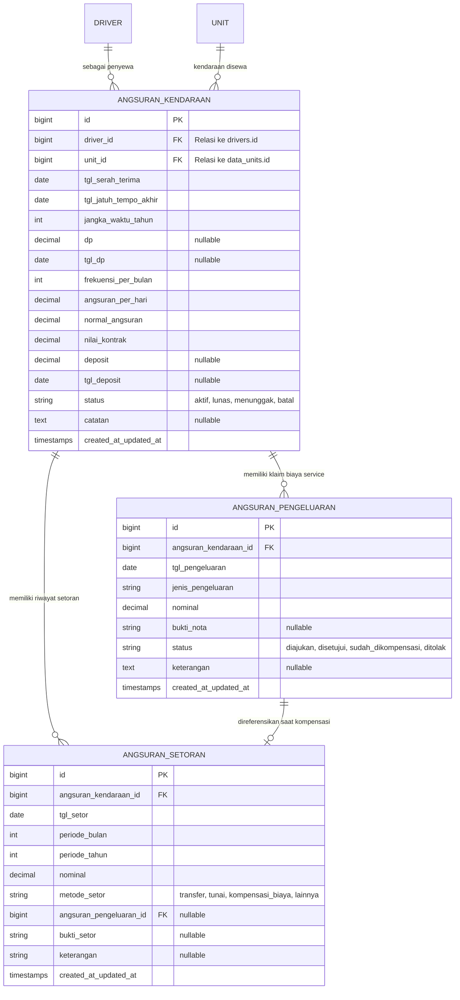

# Dokumentasi Rencana Pembaruan Fitur: Pencatatan Angsuran & Sewa Kendaraan

Dokumen ini menjelaskan spesifikasi fungsional, arsitektur database, logika bisnis, dan rencana implementasi modul **Pencatatan Angsuran & Sewa Kendaraan** pada sistem **Samarent (Laravel 12 + Filament v5)**.

---

## 1. Latar Belakang & Analisis Data Excel

Pencatatan yang sebelumnya dilakukan melalui spreadsheet Excel memiliki format dan alur bisnis sebagai berikut:

### 1.1. Kolom & Pemetaan Data
Berdasarkan data operasional dari lembar kerja Excel:

| Kolom Excel | Sumber / Tipe Data | Sifat | Deskripsi & Rumus |
| :--- | :--- | :--- | :--- |
| **Nama** | Relasi ke `drivers` (`driver_id`) | Wajib | Identitas penyewa kendaraan diambil dari master Driver (terhubung ke tabel `users`). |
| **No Pol** | Relasi ke `data_units` (`unit_id`) | Wajib | Identitas kendaraan diambil dari master Unit (Nomor Polisi, Merk, Tipe). |
| **Tgl Serah Terima** | Date | Wajib | Tanggal serah terima unit kendaraan kepada penyewa. |
| **Masa Akhir Kontrak** | Date | Wajib | Tanggal akhir masa kontrak sewa (jatuh tempo akhir). |
| **Jangka Waktu / Tahun** | Integer | Wajib | Durasi masa kontrak dalam satuan tahun (contoh: 5 tahun). |
| **DP** | Decimal / Currency | **Opsional (Nullable)** | Uang Muka (Down Payment). Kosong pada data No. 1. |
| **Tgl DP** | Date | **Opsional (Nullable)** | Tanggal pembayaran DP. Kosong pada data No. 1. |
| **Frekuensi perbulan** | Integer | Wajib | Jumlah hari/setoran dalam 1 bulan (contoh: 28 atau 27 hari setor). |
| **Angs perhari** | Decimal / Currency | Wajib | Nilai angsuran sewa harian (contoh: Rp 185.000). |
| **Normal Angsuran** | Decimal / Currency | **Otomatis** | `Frekuensi perbulan × Angs perhari` *Contoh: 28 × Rp 185.000 = Rp 5.180.000* |
| **Nilai Kontrak** | Decimal / Currency | **Otomatis** | `Normal Angsuran × 12 bulan × Jangka Waktu (Tahun)` *Contoh: Rp 5.180.000 × 12 × 5 = Rp 310.800.000* |
| **Deposit (3x Angsuran)** | Decimal / Currency | **Opsional (Nullable)** | Nilai jaminan awal, umumnya dihitung `3 × Angs perhari`. Kosong pada data No. 1. |
| **Tgl Deposit** | Date | **Opsional (Nullable)** | Tanggal penyerahan deposit. Kosong pada data No. 1. |
| **Total Setoran (Periode)** | Decimal / Currency | Akumulasi | Total setoran riil yang telah dibayarkan penyewa pada periode bulan berjalan (contoh: Juni 2026). |

> **Catatan Khusus Baris No. 1:**
> Pada data nomor 1, kolom DP, Tgl DP, Deposit, dan Tgl Deposit bernilai kosong/tidak diisi. Maka seluruh field tersebut dalam database dan form Filament dikonfigurasi sebagai **nullable/optional**.

---

## 2. Alur Operasional & Logika Bisnis Khusus

### 2.1. Pencatatan Setoran Harian
- Pencatatan pembayaran tidak dilakukan langsung secara gelondongan per bulan, melainkan **per hari (harian)** sesuai tanggal setor riil.
- Sistem akan secara otomatis mengagregasi/menjumlahkan seluruh transaksi harian tersebut ke dalam **Total Setoran Bulanan** untuk membandingkannya dengan nilai **Normal Angsuran** (Lunas / Kurang Bayar / Lebih).

### 2.2. Kompensasi Biaya Service / Kendala Kendaraan
- Jika kendaraan mengalami kendala teknis (service rutin, ganti oli, ban bocor/ganti ban, sparepart) dan penyewa menalangi perbaikan tersebut menggunakan dana pribadi, maka perusahaan berkewajiban mengganti biaya tersebut.
- Biaya tersebut dikompensasikan untuk **menutupi setoran harian** penyewa.
- **Mekanisme Perubahan Setoran:**
  - Perusahaan mencatat biaya/nota tersebut ke dalam tabel pengeluaran service.
  - Saat kompensasi dilakukan, **pemotongan TIDAK berjalan otomatis di latar belakang**.
  - **User/Admin tetap menginput transaksi setoran harian seperti biasa**, dengan memilih metode setoran: `Kompensasi Biaya/Service` dan menghubungkannya ke ID nota pengeluaran terkait.
  - Hal ini menjamin audit keuangan tetap transparan, terverifikasi, dan mudah dilacak.

---

## 3. Desain Arsitektur Database

### 3.1. Rincian Kolom Tabel

#### Tabel 1: `angsuran_kendaraans`
- `id` : Primary Key (BigInt)
- `driver_id` : Unsigned Big Integer (Foreign Key ke `drivers.id`)
- `unit_id` : Unsigned Big Integer (Foreign Key ke `data_units.id`)
- `tgl_serah_terima` : Date
- `tgl_jatuh_tempo_akhir` : Date
- `jangka_waktu_tahun` : SmallInt / Int
- `dp` : Decimal(14, 2), nullable
- `tgl_dp` : Date, nullable
- `frekuensi_per_bulan` : SmallInt (default: 28)
- `angsuran_per_hari` : Decimal(14, 2)
- `normal_angsuran` : Decimal(14, 2)
- `nilai_kontrak` : Decimal(14, 2)
- `deposit` : Decimal(14, 2), nullable
- `tgl_deposit` : Date, nullable
- `status` : Enum(`aktif`, `lunas`, `menunggak`, `batal`), default: `aktif`
- `catatan` : Text, nullable
- `timestamps`

#### Tabel 2: `angsuran_setorans`
- `id` : Primary Key (BigInt)
- `angsuran_kendaraan_id` : Unsigned Big Integer (Foreign Key ke `angsuran_kendaraans.id`, cascade)
- `tgl_setor` : Date
- `periode_bulan` : SmallInt (1 - 12)
- `periode_tahun` : SmallInt (contoh: 2026)
- `nominal` : Decimal(14, 2)
- `metode_setor` : Enum(`transfer`, `tunai`, `kompensasi_biaya`, `lainnya`), default: `transfer`
- `angsuran_pengeluaran_id` : Unsigned Big Integer, nullable (Foreign Key ke `angsuran_pengeluarans.id`, nullOnDelete)
- `bukti_setor` : String (path file upload), nullable
- `keterangan` : String / Text, nullable
- `timestamps`

#### Tabel 3: `angsuran_pengeluarans`
- `id` : Primary Key (BigInt)
- `angsuran_kendaraan_id` : Unsigned Big Integer (Foreign Key ke `angsuran_kendaraans.id`, cascade)
- `tgl_pengeluaran` : Date
- `jenis_pengeluaran` : String (contoh: "Ganti Oli Mesin", "Perbaikan Radiator", "Ganti Ban")
- `nominal` : Decimal(14, 2)
- `bukti_nota` : String (path foto nota/kuitansi), nullable
- `status` : Enum(`diajukan`, `disetujui`, `sudah_dikompensasi`, `ditolak`), default: `diajukan`
- `keterangan` : Text, nullable
- `timestamps`

---

## 4. Rencana Implementasi di Filament

### 4.1. Panel & Navigasi
- Ditempatkan pada Panel Admin dengan Navigation Group: **"Angsuran & Sewa"** atau **"Sewa Kendaraan"**.
- Resource Utama: `AngsuranKendaraanResource`.

### 4.2. Form Master Kontrak (Kalkulasi Reaktif)
1. **Dropdown Driver (`driver_id`)**:
   - Menampilkan nama driver dari relasi `users.name` dan searchable.
2. **Dropdown Kendaraan (`unit_id`)**:
   - Menampilkan `nopol` dan `merk` kendaraan dari tabel `data_units`.
3. **Kalkulator Otomatis**:
   - Perubahan pada `angsuran_per_hari` atau `frekuensi_per_bulan` langsung memperbarui `normal_angsuran`.
   - Perubahan pada `normal_angsuran` dan `jangka_waktu_tahun` langsung memperbarui `nilai_kontrak`.
   - Toggle / Tombol bantu: Hitung otomatis deposit (3x angsuran harian) dengan tetap memperbolehkan nominal dikosongkan/diubah.
   - Pilihan tanggal serah terima otomatis dapat memprediksi `tgl_jatuh_tempo_akhir` berdasarkan jangka waktu tahun.

### 4.3. Relation Manager: Setoran Harian (`SetoranRelationManager`)
- **Modal Tambah Setoran Cepat (Quick Log & Split Payment)**:
  - Input `tgl_setor`, otomatis mengisi `periode_bulan` dan `periode_tahun`.
  - Dropdown `metode_setor`: `Transfer Bank`, `Tunai`, `Kompensasi Biaya / Service (Penuh)`, `Kombinasi (Kompensasi Nota + Transfer / Tunai)`, atau `Lainnya`.
  - **Fitur Khusus Metode Kombinasi**:
    - Memilih nota service yang ingin dikompensasikan.
    - Menghitung otomatis: `Nominal Potong Nota (Kompensasi)` dan `Nominal Sisa Bayar (Transfer/Tunai)` berdasarkan `angsuran_per_hari`.
    - Otomatis mencatat 2 baris transaksi dalam 1x simpan via transaksi database (`DB::transaction`):
      1. Baris 1: Kompensasi nota service (memotong saldo nota secara real-time dan menyinkronkan status klaim).
      2. Baris 2: Pelunasan sisa via transfer/tunai (dilengkapi bukti transfer bank).
  - **Mode Edit Transaksi**:
    - Nota kompensasi yang sebelumnya telah dipilih tetap muncul di dropdown (meskipun sisa saldo nota sudah 0 atau berstatus `sudah_dikompensasi`).
    - Sinkronisasi otomatis status nota lama dan baru jika transaksi diubah atau dihapus.
  - Upload `bukti_setor` (bukti resi/transfer).
- Rekapitulasi per bulan: Menampilkan total pembayaran bulan berjalan vs Normal Angsuran.

### 4.4. Relation Manager: Biaya Service Penyewa (`PengeluaranRelationManager`)
- Form pencatatan pengeluaran yang ditalangi penyewa:
  - Input `tgl_pengeluaran`, `jenis_pengeluaran`, `nominal`.
  - Upload `bukti_nota` (nota bengkel / kwitansi).
  - Pilihan status: Diajukan $\rightarrow$ Disetujui $\rightarrow$ Sudah Dikompensasi.

### 4.5. Fitur Ekspor Data (Excel & PDF dengan Dialog Pilihan)
- **Modal Dialog Pilihan Format**:
  - **Halaman List Master**: Dialog ringkas fokus pada pemilihan format unduhan (`Excel` / `PDF`) dan filter status kontrak opsional.
  - **Halaman View Detail Kontrak**: Dialog lengkap dengan:
    1. **Format Dokumen**: `Microsoft Excel (.xlsx)` atau `Dokumen PDF (.pdf)`.
    2. **Cakupan Data**: `Lengkap (Kontrak + Histori Setoran + Biaya Service)`, `Ringkasan Kontrak Saja`, `Riwayat Setoran Harian Saja`, atau `Riwayat Biaya & Service Saja`.
    3. **Filter Rentang Tanggal**: `Tanggal Mulai (Start Date)` dan `Tanggal Akhir (End Date)` untuk memfilter histori mutasi setoran dan klaim biaya service yang diekspor.
- **Format Excel (.xlsx)**:
  - Didukung oleh `Maatwebsite\Excel` dengan template styling profesional, auto-size column, header navy bergradasi, formatting currency `Rp #,##0`, baris total di footer, dan multi-sheet sesuai cakupan data.
- **Format PDF (.pdf)**:
  - Didukung oleh `Barryvdh\DomPDF` dengan kop surat resmi PT. Samana Jaya Propertindo, logo perusahaan (`images/logo_spj_samarent.jpg`), layout A4 Landscape, badge status warna, tabel rapi, rekapitulasi nominal, label periode tanggal, serta kolom tanda tangan manajemen.
- **Titik Akses Ekspor**:
  - Halaman Index Master (`ListAngsuranKendaraans`): Tombol **"Ekspor Data"** (semua kontrak / terfilter).
  - Baris Tabel Master (`AngsuranKendaraanResource`): Tombol **"Ekspor"** per unit kendaraan.
  - Halaman Detail Kontrak (`ViewAngsuranKendaraan`): Tombol **"Ekspor Data"** di header atas dengan filter rentang tanggal.
  - Tabel Riwayat Setoran Harian (`SetoransRelationManager`): Tombol **"Ekspor Setoran"** (Rincian mutasi harian, Header & Bulk Action).
  - Tabel Biaya & Service Kendaraan (`PengeluaransRelationManager`): Tombol **"Ekspor Biaya Service"** (Rincian nota service, Header & Bulk Action).

---

## 5. Tahapan Eksekusi Teknis

1. **Tahap 1: Database Migration & Model Eloquent**
   - Membuat migrasi 3 tabel: `angsuran_kendaraans`, `angsuran_setorans`, `angsuran_pengeluarans`.
   - Membuat Model `AngsuranKendaraan`, `AngsuranSetoran`, `AngsuranPengeluaran` dengan casts dan relasi ke `Driver` dan `Unit`.
2. **Tahap 2: Filament Resource & Form Reactive**
   - Membuat `AngsuranKendaraanResource` dengan form reactive calculation dan skema tabel ringkasan.
3. **Tahap 3: Relation Managers (Setoran Harian & Biaya Service)**
   - Membuat `SetoransRelationManager` dan `PengeluaransRelationManager`.
   - Fitur pemecahan biaya service ke beberapa hari setoran harian (`pecah_ke_setoran`).
   - Dialog modal preview gambar bukti setor & nota kuitansi.
4. **Tahap 4: Fitur Ekspor Fleksibel (Excel & PDF)**
   - Membuat Exporter Excel: `AngsuranKendaraanExport`, `AngsuranSetoranExport`, `AngsuranPengeluaranExport`, `AngsuranLengkapExport` (Multi-sheet).
   - Membuat Template PDF: `pdf.angsuran-master`, `pdf.angsuran-lengkap`, `pdf.angsuran-setoran`, `pdf.angsuran-pengeluaran`.
   - Menambahkan dropdown modal pilihan format (Excel vs PDF) di seluruh titik aksi Filament.
5. **Tahap 5: Testing & Validasi**
   - Validasi data input, pengujian pembagian biaya nota, serta pengujian output file Excel dan PDF.
